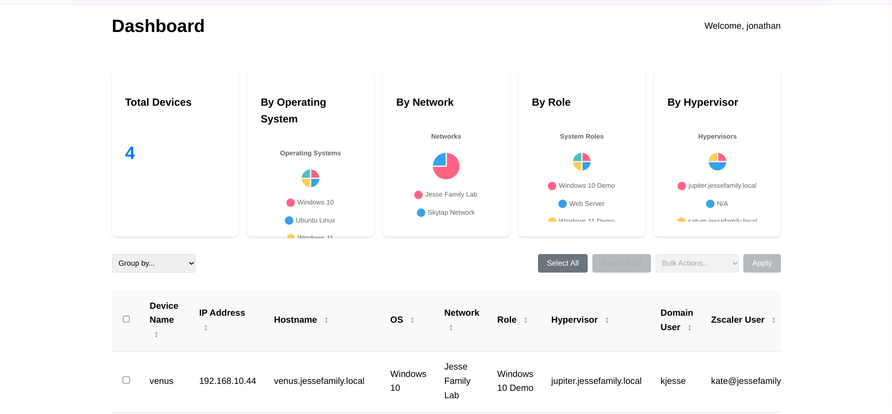

# Home Lab Web App

This web application allows you to store details about your home lab devices. You can log in to access the app and store information about each device, such as the computer name, IP address, and operating system.



## Features

- User authentication (login and registration)
- Device Management:
  - Sortable device table
  - Real-time device search
  - View device details
  - Edit device information
  - Delete devices
  - Responsive table design
- HTTPS support
- Docker containerization
- MongoDB integration
- CSV export functionality for device data

## Technologies Used

- Node.js
- Express
- MongoDB
- Passport.js
- EJS
- Docker
- express-validator
- helmet
- express-rate-limit
- csurf
- morgan

## Installation

### Local Setup

1. Clone the repository:

   ```sh
   git clone https://github.com/yourusername/homelab.git
   cd homelab
   ```

2. Install dependencies:

   ```sh
   npm install
   ```

3. Set up MongoDB:
   Make sure you have MongoDB installed and running. The app uses a local MongoDB instance by default.

4. Start the application:

   ```sh
   npm start
   ```

5. Open your browser and navigate to `http://localhost:5000`.

### Docker Setup

1. Clone the repository:

   ```sh
   git clone https://github.com/yourusername/homelab.git
   cd homelab
   ```

2. Create a .env file:

   ```sh
   cp .env.example .env
   ```

   Then edit the .env file with your settings.

3. Build the Docker image:

   ```sh
   docker-compose build
   ```

4. Start the Docker container:

   ```sh
   docker-compose up
   ```

5. Open your browser and navigate to `https://localhost:8443` or `http://localhost:8080`.

   **Note:** The Docker setup now includes a defined network for service communication and a health check for the MongoDB service.

## Docker Configuration

The application is containerized using Docker with the following features:

### Services

- **Application**: Node.js application running on port 5000
  - Memory: 512MB (256MB reserved)
  - CPU: 0.5 cores
  - Auto-restart enabled
  - Health check endpoint: `/health`
  - JSON file logging with rotation (10MB max size, 3 files)

- **MongoDB**: Version 7.0 running on port 27017
  - Memory: 1GB
  - CPU: 1.0 cores
  - Authentication enabled
  - Health check using mongosh
  - JSON file logging with rotation (10MB max size, 3 files)
  - Persistent data storage with named volume

- **Redis**: Version 7 running on port 6379
  - Memory: 256MB
  - CPU: 0.3 cores
  - Used for session storage
  - Health check using redis-cli ping
  - Persistent data storage with named volume
  - Alpine-based image for smaller footprint

### Environment Setup

1. Create a `.env` file with the following variables:

   ```
   MONGO_USERNAME=your_username
   MONGO_PASSWORD=your_password
   JWT_SECRET=your_jwt_secret_here
   AUTH_TOKEN_EXPIRY=24h
   SESSION_SECRET=your_session_secret_here
   ```

2. Start the services:

   ```bash
   docker-compose up -d
   ```

### Logging

Both services use JSON file logging with automatic rotation:

- Maximum file size: 10MB
- Maximum number of files: 3

## Environment Variables

The following environment variables are required:

| Variable | Description | Default |
|----------|-------------|---------|
| JWT_SECRET | Secret key for JWT token generation | Required |
| AUTH_TOKEN_EXPIRY | JWT token expiry time (e.g., "1d" for one day) | "1d" |
| MONGODB_URI | MongoDB connection string | "mongodb://localhost:27017/homelab" |
| PORT | Application port | 5000 |
| SESSION_SECRET | Secret for express-session | Required |
| SSL_KEY_PATH | Path to SSL private key file | "./certs/server.key" |
| SSL_CERT_PATH | Path to SSL certificate file | "./certs/server.crt" |

Create a `.env` file in the project root with these variables:

```sh
JWT_SECRET=your_secret_key_here
AUTH_TOKEN_EXPIRY=1d
MONGODB_URI=mongodb://localhost:27017/homelab
PORT=5000
SESSION_SECRET=your_session_secret_here
SSL_KEY_PATH=./certs/server.key
SSL_CERT_PATH=./certs/server.crt
```

### Setting JWT_SECRET and SESSION_SECRET

Both secrets should be:

- At least 32 characters long
- Random and unpredictable
- Unique for each environment
- Never committed to version control

You can generate secure secrets using Node.js:

```sh
# Generate JWT_SECRET
node -e "console.log('JWT_SECRET=' + require('crypto').randomBytes(32).toString('hex'))"

# Generate SESSION_SECRET
node -e "console.log('SESSION_SECRET=' + require('crypto').randomBytes(32).toString('hex'))"
```

Copy the generated strings to your .env file:

```sh
JWT_SECRET=generated_jwt_secret_from_above_command
SESSION_SECRET=generated_session_secret_from_above_command
```

### SSL Configuration

1. Generate self-signed certificates (for development):

   ```sh
   mkdir certs
   cd certs
   openssl req -x509 -nodes -days 365 -newkey rsa:2048 -keyout server.key -out server.crt
   ```

   When prompted, fill in the certificate details. For local development, you can use:
   - Common Name (CN): localhost
   - Organization Name (O): HomeLabDev
   - The rest can be left as default

2. Set proper permissions (Unix systems):

   ```sh
   chmod 600 server.key
   chmod 644 server.crt
   ```

3. Add certificate paths to .env:

   ```sh
   SSL_KEY_PATH=./certs/server.key
   SSL_CERT_PATH=./certs/server.crt
   ```

4. For production:
   - Replace with valid SSL certificates from a trusted provider
   - Never use self-signed certificates in production
   - Consider using Let's Encrypt for free SSL certificates

#### Troubleshooting SSL

- **Certificate Not Trusted**: When using self-signed certificates, your browser will show a warning. This is normal in development. Click "Advanced" and "Proceed" to continue.
- **Certificate Not Found**: Make sure the certificates are properly mounted in Docker by checking the volume mapping in docker-compose.yml
- **Permission Issues**: Ensure the certificates are readable by the node process in the container

## Production Deployment

### Automatic Startup Configuration

1. Copy the application to /opt/homelab:

   ```bash
   sudo mkdir -p /opt/homelab
   sudo cp -r . /opt/homelab/
   ```

2. Set proper permissions:

   ```bash
   sudo chown -R root:root /opt/homelab
   sudo chmod -R 755 /opt/homelab
   sudo chmod 644 /opt/homelab/homelab.service
   ```

3. Install systemd service:

   ```bash
   sudo cp homelab.service /etc/systemd/system/
   sudo chmod 644 /etc/systemd/system/homelab.service
   sudo systemctl daemon-reload
   sudo systemctl enable homelab
   sudo systemctl start homelab
   ```

4. Verify service status:

   ```bash
   sudo systemctl status homelab
   ```

5. Troubleshooting Service:
   If the service fails to start:

   ```bash
   # Check service status
   sudo systemctl status homelab
   
   # Check detailed logs
   sudo journalctl -xeu homelab.service
   
   # Verify Docker permissions
   sudo usermod -aG docker $USER
   sudo systemctl restart docker
   
   # Check if docker-compose exists and is executable
   which docker-compose
   sudo chmod +x $(which docker-compose)
   
   # Verify environment file
   sudo ls -l /opt/homelab/.env
   sudo chmod 600 /opt/homelab/.env
   ```

### Production Environment Setup

1. Configure SSL certificates:

   ```bash
   sudo certbot certonly --standalone -d yourdomain.com
   ```

2. Update .env file with production settings:

   ```bash
   MONGO_USERNAME=secure_production_username
   MONGO_PASSWORD=secure_production_password
   NODE_ENV=production
   SSL_KEY_PATH=/etc/letsencrypt/live/yourdomain.com/privkey.pem
   SSL_CERT_PATH=/etc/letsencrypt/live/yourdomain.com/fullchain.pem
   ```

3. Configure automatic SSL renewal:

   ```bash
   sudo certbot renew --dry-run
   ```

### Monitoring

Monitor application logs:

```bash
sudo docker-compose logs -f
```

Monitor service status:

```bash
sudo systemctl status homelab
sudo journalctl -u homelab
```

## File Structure

```
/homelab
├── config/
│   ├── auth.js           # Authentication middleware
│   ├── passport.js       # Passport.js configuration
│   └── redis.js          # Redis configuration
├── middleware/
│   ├── errorHandler.js   # Global error handling
│   └── security.js       # Security middleware
├── models/
│   ├── Device.js        # Device data model
│   └── User.js          # User data model
├── public/
│   └── css/
│       └── style.css    # Global styles
├── routes/
│   ├── devices.js       # Device routes
│   ├── index.js         # Main routes
│   └── users.js         # User routes
├── services/
│   └── dashboard.service.ts  # Dashboard business logic
├── tests/
│   └── setup.js         # Test configuration
├── uploads/             # Temporary storage for CSV uploads
├── views/
│   ├── dashboard.ejs    # Dashboard view
│   ├── index.ejs        # Home page
│   ├── layout.ejs       # Main layout template
│   ├── login.ejs        # Login form
│   └── register.ejs     # Registration form
├── .env.example         # Environment variables template
├── .gitignore          # Git ignore rules
├── app.js              # Main application file
├── CHANGELOG.md        # Change history
├── docker-compose.yml  # Docker services configuration
├── Dockerfile          # Container build instructions
├── homelab.service     # Systemd service file
├── jest.config.js      # Jest testing configuration
├── package.json        # Dependencies and scripts
├── README.md           # Project documentation
└── wait-for-it.sh      # Docker startup script
```

## Usage

### Register

1. Navigate to the registration page: `https://localhost:8443/users/register`

### Login

1. Navigate to the login page: `https://localhost:8443/users/login`

### Add Device

1. After logging in, navigate to the dashboard: `https://localhost:8443/dashboard`
2. Fill in the device form and submit to add a new device. The form includes the following fields:
   - Device Name
   - IP Address
   - Operating System
   - Hostname
   - Network
   - System Role
   - Hypervisor Installed On
   - Domain User Signed In
   - Zscaler User Signed In
   - Zscaler App Segment
   - Notes

### View Devices

1. After logging in, navigate to the dashboard: `http://localhost:5000/dashboard`
2. Your devices will be listed under "Your Devices".

### CSV Import/Export

#### Importing Devices

1. Click the "Import CSV" button on the dashboard
2. Select a CSV file with the following headers:
   - Device Name
   - IP Address
   - Operating System
   - Hostname
   - Network
   - System Role
   - Hypervisor
   - Domain User
   - Zscaler User
   - Zscaler Segment
   - Notes

The CSV file should have a header row and follow this format:

```csv
Device Name,IP Address,Operating System,Hostname,Network,System Role,Hypervisor,Domain User,Zscaler User,Zscaler Segment,Notes
PC01,192.168.1.100,Windows 10,PC01.local,LAN,Workstation,None,user1,zuser1,segment1,Test PC
```

## Device Management

The dashboard provides a comprehensive device management interface with the following features:

### Device Table

- Displays comprehensive device information including:
  - Device Name
  - IP Address
  - Hostname
  - Operating System
  - Network
  - System Role
  - Hypervisor Information
  - Domain User
  - Zscaler User
  - Zscaler Segment
  - Notes
- Sortable columns (click column headers to sort)
- Real-time search filtering
- Responsive design for all screen sizes

### Device Actions

- Edit: Modify device properties
  - Click the "Edit" button next to a device
  - Form will be populated with device data
  - Make desired changes
  - Click "Update Device" to save changes
  - Click "Cancel" to discard changes
- Delete: Remove devices from your inventory with confirmation dialog

### Adding Devices

1. Click "Add New Device" button
2. Fill in the required fields:
   - Device Name
   - IP Address
   - Operating System
   - Hostname
   - Network
   - System Role
   - Hypervisor Information
   - Domain User
   - Zscaler Configuration
3. Add optional notes
4. Submit the form

### Search and Filter

Use the search box above the device table to filter devices by any field:

- Device name
- IP address
- Operating system
- System role

## API Routes

### Devices

- GET `/devices` - Get all devices for authenticated user
- POST `/devices/add` - Add a new device
  - Required fields: name, ipAddress, operatingSystem, hostname, network, systemRole, hypervisorInstalledOn, domainUserSignedIn, zscalerUserSignedIn, zscalerAppSegment
  - Optional fields: notes

## Security Improvements

- Added `ensureGuest` middleware to prevent authenticated users from accessing login and register pages.
- Added helmet middleware to enhance security by setting various HTTP headers.
- Implemented input validation using `express-validator` to prevent injection attacks.
- Implemented CSRF protection to prevent cross-site request forgery attacks.
- Implemented rate limiting to protect against brute-force attacks.
- Improved password hashing using `bcryptjs`.
- Enhanced session security with `httpOnly`, `secure`, and `sameSite` options.
- Utilized `morgan` for logging.

## Troubleshooting

### Device Validation Errors

If you encounter validation errors when adding a device, ensure the following:

1. All required fields are filled in the form.
2. The form field `name` attributes match the `Device` model field names exactly.
3. Check the server logs for the request body to verify the data being sent.

## Development

To run the application in debug mode:

```sh
npm run dev:debug
```

To run tests:

```sh
npm test
```

## Contributing

Please read through our contributing guidelines. Included are directions for opening issues, coding standards, and notes on development.

## Changelog

All notable changes to this project are documented in the [CHANGELOG.md](CHANGELOG.md) file.

### Fixed

- Resolved an issue where the edit button on the dashboard was not correctly populating the form with device data or submitting changes properly.

## License

This project is licensed under the MIT License.
